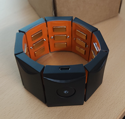
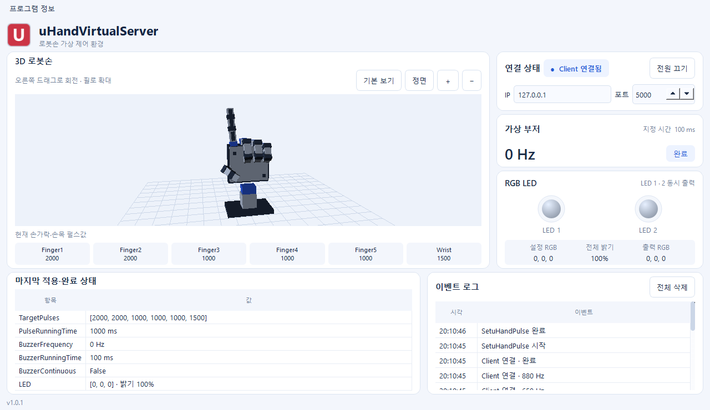
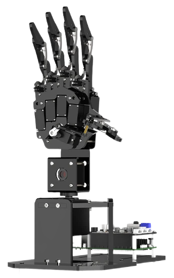

# EMGRobotHandTheater

EMG 암밴드를 착용한 사람이 손짓하면, 로봇손이 손가락에 연결된 줄을 움직여 인형극을 공연하는 Python 프로젝트입니다.

## 세 파트의 역할

1. **파트 1 · EMG 분류** — 암밴드에서 측정한 근육 신호로 여덟 가지 손짓을 구분하고, 어떤 손짓인지 나타내는 번호(동작 ID `0~7`)를 통합 프로그램에 보냅니다.
2. **파트 2 · 로봇손 통합 제어** — 전달받은 번호에 맞는 공연 파일을 골라 로봇손에서 반복 재생합니다. 다른 번호가 들어오면 진행 중인 카드를 마치고 새 장면으로 전환합니다.
3. **파트 3 · 인형 동작 제작** — uHandMotionCreator로 손짓마다 어떤 인형 동작을 보여줄지 정하고, 통합 프로그램이 재생할 여덟 개의 공연 파일(`.uhjson`)을 만듭니다.

**현재 이 저장소에는 파트 1과 파트 2가 구현되어 있고, 파트 3의 공연 파일 8개가 들어 있습니다.**

예를 들어 사람이 주먹을 쥐면 분류기가 숫자 `6`을 보냅니다. 프로그램은 `sequences/action_06.uhjson`을 골라 반복 재생합니다. 그 파일에 인형이 인사하는 동작을 넣었다면, 주먹을 쥐고 있는 동안 인형이 인사합니다.

## 처음 실행해 보기

1. **Python 3.10 이상**을 준비합니다. 프로젝트 전체를 클론하거나 ZIP을 받아 압축을 풉니다. `main.py`, `Setup.ini`, `third_party`가 보이는 폴더에서 터미널을 엽니다.
2. 아래 명령 하나를 실행합니다. 파트 2에는 추가 패키지 설치가 필요 없습니다. uHandClientModule 1.0.1이 함께 들어 있습니다. 암밴드로 실제 분류를 하려면 먼저 `python -m pip install -r requirements.txt`로 파트 1의 패키지(numpy, pyserial, scikit-learn, joblib)를 설치합니다.

   ```sh
   python main.py
   ```

   Mac 등에서 Python 3 명령이 `python3`이면 `python3 main.py`로 실행합니다.
3. 콘솔에 프로그램 버전, 읽은 설정 파일의 경로, 서버 주소, 동작 파일 로드 결과가 표시됩니다. 기본 서버 주소는 실물 로봇손의 `192.168.61.1:5000`입니다. 서버가 꺼져 있으면 연결을 재시도합니다.
4. **첫 실행에서 ‘순환 시험 꺼짐’, ‘EMG 입력 대기’가 나오면 정상입니다.** 이어서 모델 이름과 암밴드 포트가 표시됩니다. 암밴드 수신기가 꽂혀 있지 않으면 찾을 때까지 기다리며, 그동안 공연 동작은 시작하지 않습니다. 서버와 연결할 때는 서버 자체가 준비 자세로 복귀하고 연결음을 냅니다.
5. 종료할 때는 터미널에서 **Ctrl+C**를 누릅니다. 진행 중인 로봇 명령을 마치고 두 워커와 연결을 정리합니다.

### 장비 없이 첫 동작 보기

1. 별도로 uHandControl 1.0.1 런처에서 **uHandVirtualServer**를 켜고 연결 대기를 확인합니다. MotionCreator가 이미 연결돼 있다면 연결을 해제합니다. 서버는 한 번에 한 클라이언트가 제어합니다. [uHandControl 1.0.1 다운로드와 실행 안내](https://github.com/SonYeongDong/uHandControl/releases/tag/v1.0.1)
2. 통합 프로그램을 종료한 상태에서 `Setup.ini`의 `[server]` 아래 `ip`를 `127.0.0.1`로, `[test]` 아래 `cycle_enabled`를 `true`로 바꾸고 저장합니다. 포트는 가상 서버에 표시된 값과 일치시킵니다.
3. `python main.py`를 실행합니다. 연결과 초기화가 끝나면 시험 워커가 **0 → 1 → … → 7 → 0** 순서로 3초마다 동작을 요청합니다. 코드 수정이나 암밴드가 필요 없습니다.
4. 아직 공연 파일이 없으면 **빨간 LED와 연속음은 파일이 없다는 표시**입니다. 예를 들어 ID 0에서는 손을 쥔 채 손목을 좌우로 흔들고, ID 5에서는 중지와 소지를 굽혔다 폅니다.
5. 시험 후 Ctrl+C로 종료하고 `cycle_enabled = false`로 되돌립니다. 실물로 전환할 때는 서버 IP를 `192.168.61.1`로 복원하고 PC와 로봇손을 Ethernet으로 연결합니다. 실물에서도 시험 모드를 켜면 같은 동작이 재생됩니다.

## EMG 암밴드로 연동 테스트하기

실제 손짓이 원하는 공연 장면을 선택하는지 확인하는 시험입니다. 파트 1의 분류 로직을 연결한 뒤 진행하세요. 분류기를 아직 개발 중이라면 위의 [장비 없이 첫 동작 보기](#장비-없이-첫-동작-보기)로 서버와 공연 파일을 먼저 시험할 수 있습니다.

### 1. 암밴드의 분류 결과를 프로그램에 연결하기



[emg_worker.py](emg_thread/emg_worker.py)의 `run_emg_worker(stop)`이 암밴드 신호를 읽고 모델로 분류해, 새 판정이 나올 때마다(초당 약 10회) `robot_hand_control.set_action(동작 ID)`를 호출합니다. 예를 들어 주먹을 인식하면 `6`을 보냅니다. 암밴드 수신기(CH340)를 USB에 꽂고 밴드를 켠 뒤 **모델을 학습할 때와 같은 위치**로 착용하세요. [파트 1의 동작과 설정](#파트-1--분류-결과를-보내는-방법)

### 2. 가상 서버와 실물 로봇손 중 하나 준비하기

| | PC에서 가상 로봇손으로 시험 | 실물 로봇손으로 시험 |
| --- | --- | --- |
| 장비·화면 | [](docs/images/virtual-number-one.png) |  |
| 시작 방법 | 같은 PC에서 uHandControl 런처를 열고 **uHandVirtualServer**를 선택합니다. 창 오른쪽 위에 **연결 대기**가 표시될 때까지 기다립니다. | PC와 로봇손을 Ethernet 케이블로 연결하고 로봇손을 켭니다. uHandControl 배포 이미지에서는 **uHandServer**가 자동으로 시작합니다. 도·미·솔 준비음이 끝날 때까지 기다립니다. |
| `Setup.ini`의 `[server]` | 기본값은 `ip = 127.0.0.1`, `port = 5000`입니다. 포트를 바꿨다면 가상 서버 창에 표시된 값을 입력합니다. | `ip = 192.168.61.1`, `port = 5000`입니다. 처음 연결한다면 [유선 네트워크 설정](https://github.com/SonYeongDong/uHandControl/blob/v1.0.1/docs/hardware-setup.md)을 확인하세요. |

uHandMotionCreator로 서버를 사용하고 있었다면 먼저 연결을 해제하세요. 각 서버에는 한 번에 한 클라이언트만 연결할 수 있습니다.

### 3. 손짓 하나로 연결부터 장면 재생까지 확인하기

1. 통합 프로그램을 종료한 상태에서 `Setup.ini`의 `[test]`에 **`cycle_enabled = false`** 설정을 적용합니다. 이 값이어야 실제 EMG 워커가 실행됩니다. 시험 중 콘솔에서 동작 번호를 보려면 `[debug]`의 `enabled = true`도 설정하세요.
2. 주먹에 대응하는 공연 파일을 `sequences/action_06.uhjson`에 넣고 프로젝트 폴더에서 `python main.py`를 실행합니다. 콘솔에 **로봇손 연결 완료 · 입력 대기**가 표시되면 암밴드를 착용하고 주먹을 쥐세요.
3. **콘솔에서** 요청 ID가 `6`으로 바뀌는지 확인합니다. 이어서 재생 ID가 `6`이 되고 카드 시작 로그가 나오면 주먹에 해당하는 장면을 실행한 것입니다. 다른 장면을 재생 중이었다면 진행하던 카드를 마친 뒤 전환합니다.
4. **가상 서버에서는** 왼쪽 3D 손과 오른쪽 아래 이벤트 로그를, **실물에서는** 로봇손의 움직임과 파일에 지정한 LED·부저 출력을 확인하세요. 예를 들어 6번 파일에 인사 동작을 저장했다면 **사람은 주먹을 쥐고 로봇손은 인사 동작을 재생**하는 것이 기대 결과입니다.

6번 파일이 없어도 ID 전달과 연결은 시험할 수 있습니다. 이때는 6번의 파일 누락 표시 동작이 재생되므로, 실제 공연 장면을 확인하려면 파일을 추가한 뒤 통합 프로그램을 다시 시작하세요.

## 내가 맡은 파트는 어디에서 작업하나요?

| 담당 | 열어 볼 위치 | 팀원이 추가할 내용 |
| --- | --- | --- |
| **파트 1 · EMG 분류** | [emg_thread/](emg_thread/), [models/](models/) | 암밴드 연결, 신호 이상 감지, 모델 추론, 동작 확정을 하고 새 결과를 정수 ID로 전달합니다. |
| **파트 2 · 통합 제어** | [common/robot_hand_control.py](common/robot_hand_control.py), [robot_thread/](robot_thread/) | 요청 ID 관리, 3초 입력 감시, 파일 로드, 연결·재접속, 카드 반복을 담당합니다. |
| **파트 3 · 인형 동작** | [sequences/](sequences/) | uHandMotionCreator로 만든 파일 8개를 아래 표의 이름으로 복사합니다. Python 코드는 작성할 필요가 없습니다. |

### 파트 1 — 분류 결과를 보내는 방법

`main.py`가 시작한 EMG 워커가 아래 순서로 동작합니다. 코드는 [emg_thread/classifier.py](emg_thread/classifier.py)의 `EmgClassifier`에 있습니다.

1. **암밴드 연결** — 수신기(CH340)를 찾아 연결합니다. 찾지 못하거나 연결이 끊기면 2초마다 다시 시도합니다. 암밴드는 HEX 500 Hz 모드여야 합니다. ASCII 모드면 밴드 버튼을 한 번 눌러 바꿉니다.
2. **분류** — `models/`의 랜덤포레스트 모델이 최근 500 ms의 8채널 신호로 여덟 가지 손짓의 확률을 냅니다(초당 약 10회).
3. **동작 확정** — 새 손짓이 확률 60% 이상으로 3회 연속 나오면 그 손짓으로 바꿉니다. 두 손짓 사이에서 판정이 흔들릴 때 장면이 계속 바뀌는 것을 막습니다.
4. **전달** — 새 판정이 나올 때마다 확정된 손짓의 ID로 `set_action`을 호출합니다. 같은 손짓을 유지하는 동안에도 계속 보내므로 통합 프로그램의 3초 입력 감시가 동작합니다.
5. **신호 이상** — 연결 끊김, 수신 멈춤, ASCII 모드를 감지하면 `set_action(-1)`을 한 번 보내고, 신호가 정상으로 돌아올 때까지 아무것도 보내지 않습니다.

`Setup.ini`에 `[emg]` 섹션을 추가해 바꿀 수 있습니다. 섹션이 없으면 아래 기본값을 씁니다.

```ini
[emg]
port = auto
model = 500그루
min_prob = 0.6
hold = 3
```

| 키 | 기본값 | 용도 |
| --- | --- | --- |
| `port` | `auto` | `auto`는 수신기를 자동으로 찾습니다. `COM4`처럼 직접 지정할 수 있습니다. 암밴드 없이 시험할 때는 `demo`(합성 신호, 판정에 의미 없음) 또는 `replay:<녹화 세션 폴더>`(녹화한 신호를 반복 재생)를 씁니다. |
| `model` | `500그루` | `models/`에서 이름에 이 글자가 들어간 모델 파일을 씁니다. `300그루`로 바꾸면 다른 파일을 씁니다. |
| `min_prob` | `0.6` | 새 손짓으로 바꾸는 데 필요한 확률 |
| `hold` | `3` | 그 확률이 연속으로 나와야 하는 횟수. 올리면 덜 흔들리고 0.1초씩 늦어집니다. |

**모델 파일.** `models/`에는 같은 이름(`random_forest_500ms.joblib`)으로 전달받은 두 파일을 구분해 넣었습니다. 11-25 전달본은 나무 500그루, 11-22 zip에 든 것은 300그루입니다. 랜덤포레스트는 착용 보정이 없어 밴드 위치나 신호 중심값이 학습 때와 다르면 정확도가 크게 떨어집니다. `.joblib`은 읽을 때 코드를 실행할 수 있는 형식이라, scikit-learn 숲과 numpy 배열 클래스만 허용하는 방식으로 읽습니다.

**함수.** 다른 분류기를 연결하거나 시험 코드를 작성할 때는 아래 두 함수를 씁니다. 별도 프로세스에서 호출하면 상태가 공유되지 않으므로 `main.py`가 시작한 EMG 워커 안에서 호출합니다.

| 함수 | 입력·반환과 동작 |
| --- | --- |
| `set_action(action_id)` | 등록된 Python 정수 또는 `-1`을 받고 즉시 `None`을 반환합니다. 정수 이외의 값·`bool`은 `TypeError`, 등록되지 않은 정수는 `ValueError`입니다. |
| `get_current_action()` | 현재 재생 중인 시퀀스의 정수 ID를 반환합니다. 대기·연결 두절·정지 복귀 중에는 `-1`입니다. 실제 손가락 위치를 측정하는 함수는 아닙니다. |

**전환 예시.** ID 3의 손목 카드가 움직이는 동안 ID 6을 보내도 조회값은 아직 3입니다. 그 카드를 마치고 6을 시작하면 조회값이 바뀝니다. 카드 도중 여러 일반 ID가 들어오면 최신 ID를 사용합니다. `-1`이나 입력 두절이 끼면 먼저 준비 자세를 한 번 거친 뒤 유효한 최신 요청을 사용합니다. 연결이 끊긴 동안의 요청은 버리고 재접속 후 새 입력부터 시작합니다.

### 파트 3 — 만든 장면을 연결하는 방법

1. **uHandMotionCreator 1.0.1**에서 손동작·부저·LED 카드를 원하는 순서대로 만들고 한 번 미리 재생합니다.
2. **다른 이름으로 저장**에서 아래 파일명을 정확히 입력해 `sequences/`에 저장하거나 복사합니다. 예를 들어 주먹이 들어왔을 때 공연할 장면은 `sequences/action_06.uhjson`입니다.
3. 통합 프로그램을 재시작합니다. 시작할 때 파일을 한 번 읽으므로, 실행 중 교체한 파일은 다음 실행부터 적용됩니다. 콘솔에서 등록·로드·누락·보류 수를 확인합니다.
4. 위의 **장비 없이 첫 동작 보기**를 따라 여덟 장면의 대응과 전환을 확인한 뒤 실물에서 줄의 움직임을 맞춥니다.

| ID | 분류 손짓 | 파일명 |
| ---: | --- | --- |
| 0 | 휴식 | `action_00.uhjson` |
| 1 | 검지 펴기 | `action_01.uhjson` |
| 2 | 엄지 쭉 꺾기 | `action_02.uhjson` |
| 3 | 손목 젖히기 | `action_03.uhjson` |
| 4 | 손목 굽히기 | `action_04.uhjson` |
| 5 | 손 펴기 | `action_05.uhjson` |
| 6 | 주먹 | `action_06.uhjson` |
| 7 | 새끼손가락 쪽으로 꺾기 | `action_07.uhjson` |

- **휴식과 정지** — `0`은 제작한 휴식 장면을 반복합니다. `-1`은 파일 없이 현재 카드를 마치고 LED·부저를 끈 뒤 여섯 축을 1500으로 복귀시킵니다(500ms). 마지막 유효 입력 후 3초 동안 새 입력이 없어도 같은 처리를 합니다.
- **카드 길이** — 장면 전환은 카드 사이에서 일어납니다. 긴 카드가 진행 중이면 다음 장면이 늦어질 수 있습니다. 리허설 때 장면을 바꾸고 싶은 지점에서 카드를 나눠 주세요.
- **빛과 소리** — 일반 부저와 손동작 카드는 지정 시간만큼 진행합니다. LED와 연속 부저는 즉시 적용됩니다. 시간 지정 카드가 하나도 없으면 출력들을 순서대로 한 번 적용하고 기다립니다. 여러 색을 일정한 간격으로 반복하려면 사이에 **0Hz 일반 부저 카드**를 넣어 대기 시간을 지정하세요. 정상 장면의 지속 출력은 다음 출력 명령까지 유지되므로 장면에 필요한 색·소리를 명시하세요.
- **파일 누락과 손상** — 누락 시 요청된 ID만 대체 동작으로 재생합니다. 빨간 LED 50%와 ID별 음을 유지하고, 손동작은 편도 300ms입니다. 손상되거나 비어 있는 파일은 보류하고 콘솔에 파일명과 가능한 경우 카드 번호를 표시합니다. 정상 파일은 계속 사용할 수 있습니다.
- **파일 형식** — 새 파일은 스키마 2를 사용합니다. 스키마 1의 불리언 LED도 지원합니다. 손동작은 각도가 아닌 서보 펄스값입니다. 최대 5 MiB, 5,000장입니다.

## 설정 바꾸기

`main.py` 옆 [Setup.ini](Setup.ini)를 수정하고 프로그램을 재시작합니다.

| 위치 · 키 | 기본값 | 용도 |
| --- | --- | --- |
| `[server] ip` | `192.168.61.1` | 실물 서버 주소. 같은 PC의 가상 서버는 `127.0.0.1` |
| `[server] port` | `5000` | 서버에 표시된 포트와 일치시킵니다. |
| `[output] led_enabled` | `true` | `false`이면 공연과 누락 표시의 LED를 끕니다. |
| `[output] buzzer_enabled` | `true` | `false`이면 공연과 누락 알림음을 끕니다. 일반음의 대기 시간은 유지합니다. 서버 자체의 연결음 등은 서버가 재생합니다. |
| `[debug] enabled` | `false` | `true`이면 시각, 요청 ID, 실제 재생 ID, 카드 진행을 출력합니다. |
| `[test] cycle_enabled` | `false` | `true`이면 서버 준비 후 3초마다 다음 ID를 요청합니다. 재접속 후에는 첫 ID부터 시작합니다. |
| `[emg]` 섹션 (선택) | 없음 | 암밴드 포트, 모델, 동작 확정 조건. [파트 1의 설정](#파트-1--분류-결과를-보내는-방법) |

설정 파일이 없으면 기본값으로 생성합니다. 값이나 형식이 잘못됐으면 기존 내용을 `Setup.ini.<시각>.bak`에 보존하고 전체 기본값을 복원합니다. 복원된 파일에는 `[emg]` 섹션이 없으므로 파트 1은 기본값으로 동작합니다. 한글 경로를 적을 때는 파일을 UTF-8로 저장하세요. 주소가 유효하지만 접속만 실패하면 설정을 보존한 채 재시도합니다.

## 폴더 한눈에 보기

```text
main.py                         실행 진입점, 두 스레드 시작·종료
Setup.ini                       팀원이 바꾸는 실행 설정
common/settings.py              프로그램 버전, 분류 ID 이름, 설정 처리
common/robot_hand_control.py    두 공개 함수와 스레드 간 공유 상태
emg_thread/emg_worker.py        파트 1 실제 분류 진입점과 별도 순환 시험
emg_thread/classifier.py        파트 1의 암밴드 → 모델 → 확정 동작 → 동작 ID
emg_thread/emg_settings.py      Setup.ini의 [emg] 설정
emg_thread/sensor/              암밴드 수신과 신호 이상 감지
emg_thread/models/              모델 읽기와 특징 계산 (rf_features.py)
emg_thread/decide/              동작 확정 (stabilizer.py)
models/                         파트 1의 모델 파일 (*.joblib)
requirements.txt                파트 1에 필요한 패키지
tests/                          파트 1 테스트 (python -m unittest discover -s tests)
robot_thread/sequence_loader.py 파일 검증, 카드 읽기, 누락 동작 생성
robot_thread/robot_hand_worker.py  파트 2의 연결·재생·재접속
sequences/                      파트 3의 공연 파일을 넣는 곳
third_party/uhand_client_module/   동봉한 uHandClientModule 1.0.1
```

동작을 늘리면 `common/settings.py`의 `ACTIONS`에 새 ID를 등록하고 같은 번호의 파일을 추가하세요. 기존 ID는 유지합니다. 누락 표시는 0~15까지 정의돼 있습니다. 통신 패키지는 [uHandControl v1.0.1 원본](https://github.com/SonYeongDong/uHandControl/tree/v1.0.1/projects/uhand-client-module/src/uhand_client_module)에서 가져왔습니다. 공연 로직은 `robot_thread/`에서 관리합니다.

## 검증 범위

Windows에서 별도 패키지 없는 파트 2 실행, 설정 복구, 3초 입력 감시, 가상 서버의 전체 순환과 재접속을 확인했습니다. uHandVirtualServer와 실물 uHandServer에서 손동작·LED·부저·누락 표시·준비 자세 복귀를 검증했고, 실물 재시험에서 손가락·손목, LED, 부저, 종료 상태를 관찰했습니다. 파트 1은 테스트 8개(합성 신호로 분류·전달·암밴드 두절·재연결, 전달받은 모델 실행, 설정)와, 녹화한 암밴드 신호를 재생해 손짓 → 요청 ID → 장면 재생이 이어지는 것을 가짜 서버로 확인했습니다(2026-11-28). 실제 암밴드를 연결한 실행과 인형극 리허설은 아직 확인하지 못했습니다. `emg_thread/sensor/`는 sichiray-emg-studio(MIT, `emg_thread/sensor/LICENSE.studio`)의 수신 코드입니다.

## 프로젝트 팀


**인하대학교 · 2026 Data Science Team 1**

- 손영동 (Yeong-dong Son)
- 이민지 (Min-ji Lee)
- 이상윤 (Sang-yun Lee)
- 정한결 (Han-gyeol Jeong)
- 조승준 (Seung-jun Jo)
